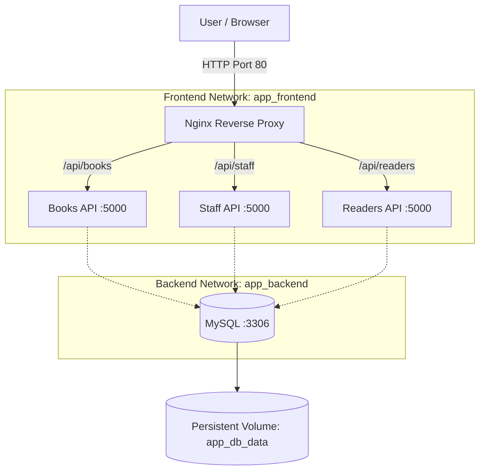

# Assignment 2: Multi-Container Application Deployment

## Project Overview

This project deploys a library application using Docker Compose. It includes three FastAPI microservices, a MySQL database, and an Nginx reverse proxy.

## Application Services

| Service | Description |
|---|---|
| Books API | Returns the list of books |
| Staff API | Provides staff information |
| Readers API | Provides reader information |
| MySQL | Database service |
| Nginx | Reverse proxy for API requests |

## Architecture Diagram



The dotted lines represent database network connectivity configured for future integration. The APIs do not currently perform database queries.

## Network Configuration

The application uses two Docker networks:

- **Frontend (`app_frontend`):** Connects Nginx with the three API services.
- **Backend (`app_backend`):** Connects the three API services with MySQL.

Nginx receives HTTP requests on port 80 and forwards them to the correct API service on port 5000.

MySQL is connected only to the backend network and is not directly exposed to the host computer.

## Setup Instructions

1. Install Docker Desktop.
2. Open the Assignment2 project folder in VS Code.
3. Create a `.env` file containing:

```env
DB_USER=appuser
DB_PASSWORD=your_password
DB_NAME=librarydb
DB_ROOT_PASSWORD=your_root_password
```

Replace the example passwords with your own values. Do not commit the `.env` file to a public repository.

4. Start the application:

```bash
docker compose up -d --build
```

5. Verify the containers:

```bash
docker compose ps
```

## API Endpoints

| Endpoint | Description |
|---|---|
| `/health` | Nginx health check |
| `/api/books` | Returns the books list |
| `/api/staff` | Returns staff information |
| `/api/readers` | Returns reader information |

All endpoints are accessible through `http://localhost`.

## Health Checks

Each FastAPI service provides a `/health` endpoint that returns:

```json
{"status":"healthy"}
```

Docker Compose checks the health of all three API services.

## Database Configuration

The project uses MySQL 8.0.

Database credentials are configured using environment variables from the `.env` file.

The named Docker volume `app_db_data` stores MySQL data so that records remain available after the database container restarts.

The database is accessible to the API services through the backend network.

## Verification

The following tests were completed successfully:

- All five containers started.
- All three API containers reported healthy status.
- Nginx returned HTTP 200 for its health endpoint.
- Books API returned HTTP 200 through Nginx.
- Staff API returned HTTP 200 through Nginx.
- Readers API returned HTTP 200 through Nginx.
- Books API established a network connection to MySQL on port 3306.
- MySQL authentication succeeded using the configured credentials.
- A database record remained available after restarting MySQL.

## Troubleshooting

### Containers Are Not Running

```bash
docker compose up -d
docker compose ps
```

### View Container Logs

```bash
docker compose logs
```

### Rebuild Application Services

```bash
docker compose up -d --build
```

### Stop the Application

```bash
docker compose down
```

Do not use `docker compose down -v` if you want to preserve the MySQL database volume.
